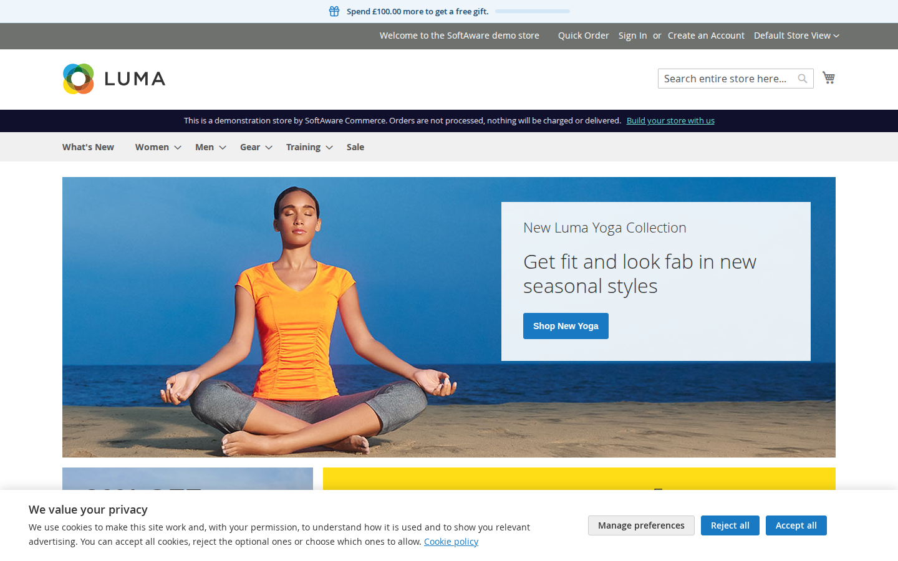
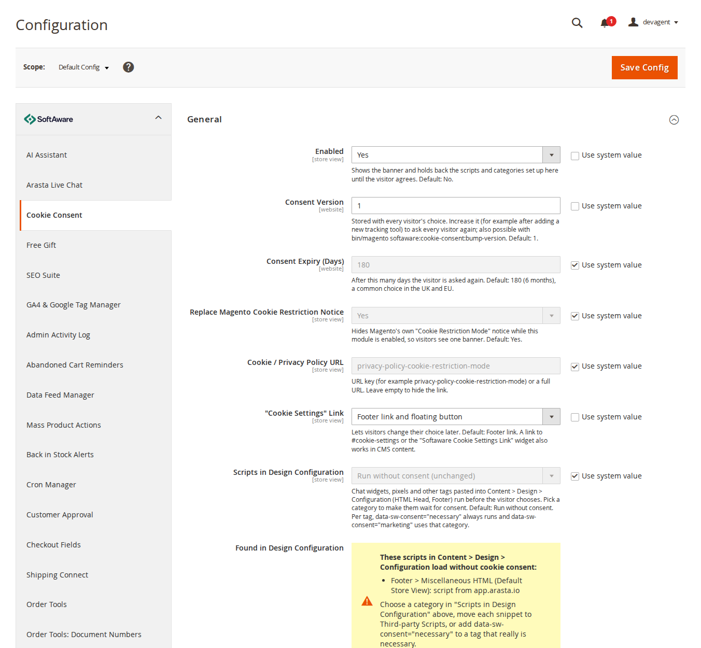
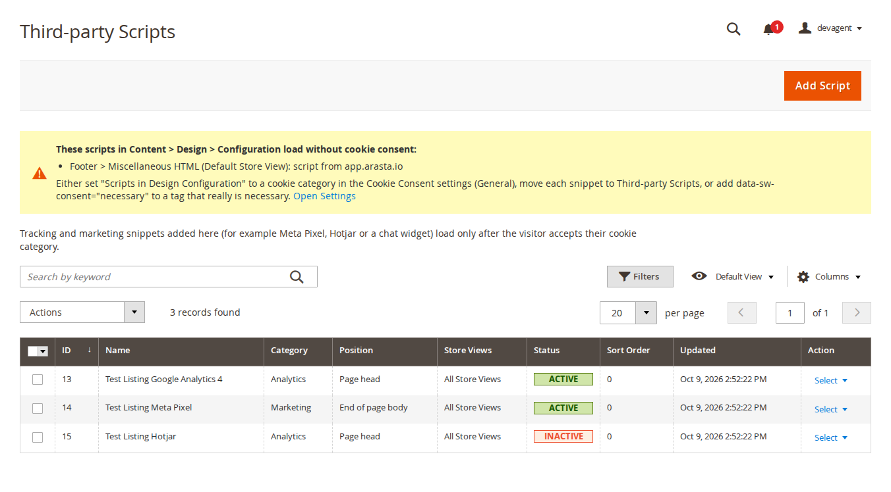
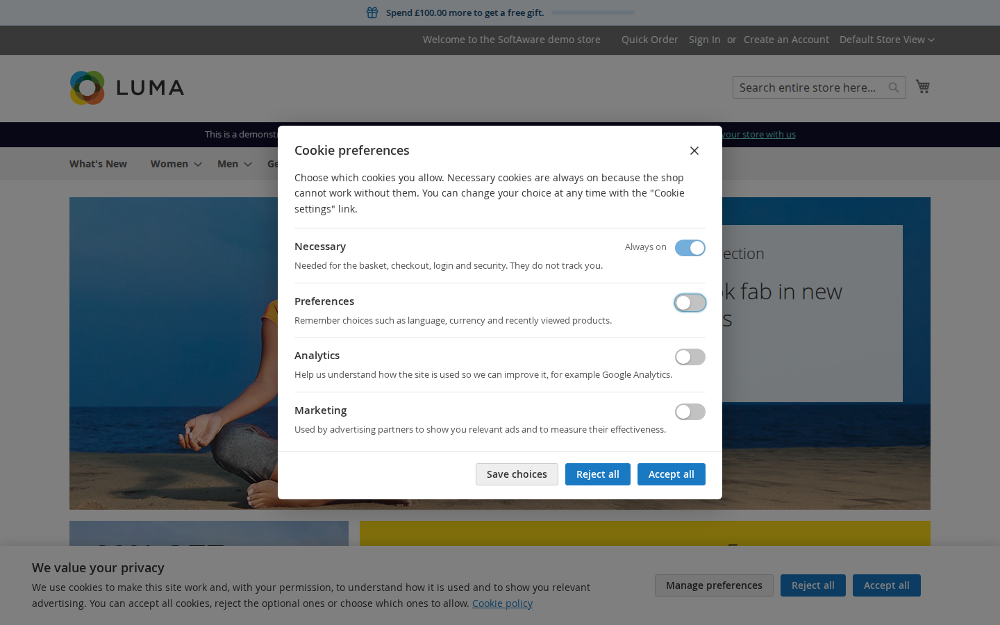
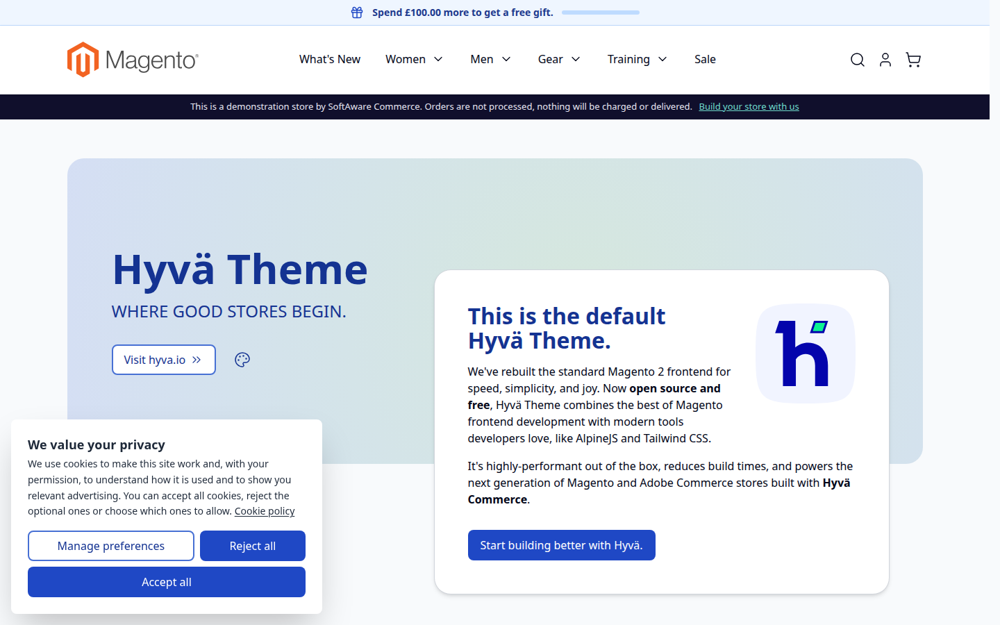
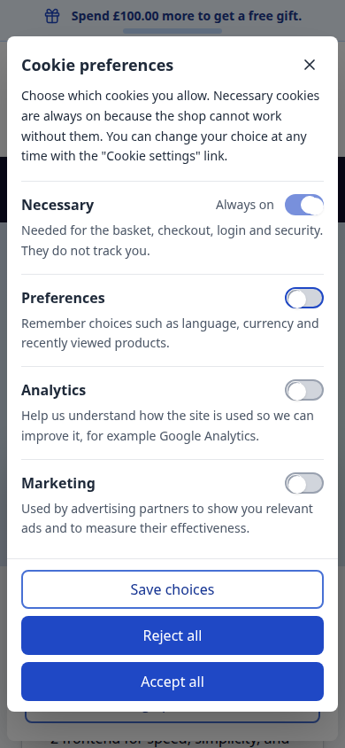
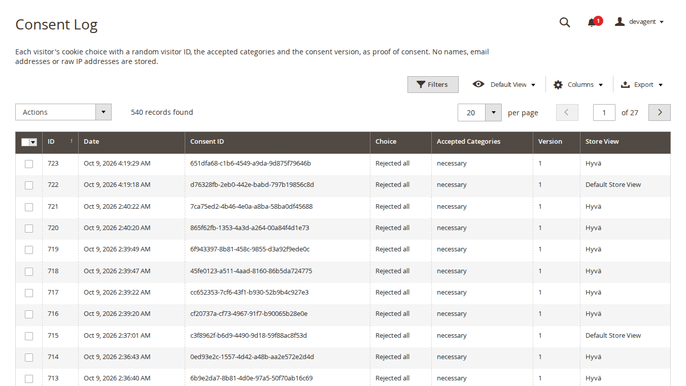

# Cookie Consent for Magento 2: User Guide

A cookie banner and preferences window with **Google Consent Mode v2**, third-party scripts that wait for consent and
an optional consent log. This guide covers installation, every setting and day-to-day use.

- Demo (Luma): https://demo.softawarecommerce.com/
- Demo (Hyvä): https://demo.softawarecommerce.com/hyva/
- Admin demo: https://demo.softawarecommerce.com/try-admin/cookie-consent
- Changelog: [CHANGELOG.md](../CHANGELOG.md) · Questions: [FAQ](faq.md)



A note before you start: the module does what this guide describes and nothing more. Which tags you run, how you
categorise them and what your cookie policy says are your decisions; take legal advice if you are unsure what applies
to your shop.

## 1. Requirements

| | |
| --- | --- |
| Magento | Open Source or Adobe Commerce 2.4.7 to 2.4.9 |
| PHP | 8.2 to 8.5 |
| Themes | Luma, Blank and themes based on them; Hyvä 1.3+ |
| Other | `softaware/module-core` (installed automatically) |

## 2. Installation

Cookie Consent is free. Install it with Composer from repo.softawarecommerce.com, using the Composer keys from your
account on softawarecommerce.com (see https://softawarecommerce.com/shop/composer-access/):

```bash
composer config repositories.softaware composer https://repo.softawarecommerce.com
composer config --auth http-basic.repo.softawarecommerce.com PUBLIC_KEY PRIVATE_KEY
composer require softaware/module-cookie-consent
bin/magento setup:upgrade
bin/magento setup:di:compile            # production mode only
bin/magento setup:static-content:deploy # production mode only
bin/magento cache:flush
```

On Hyvä the module's templates are picked automatically, and the module registers itself for Tailwind source
scanning. If you build your theme's CSS yourself, run your usual Hyvä build after installing.

To update later: `composer update softaware/module-cookie-consent`, then the same `bin/magento` commands.

## 3. Quick start

1. Open **Stores > Configuration > Softaware > Cookie Consent** (also under **Softaware > Cookie Consent > Settings**).
2. **General > Enabled = Yes**. The module is off after installation, so nothing changes until you switch it on.
3. Set **Cookie / Privacy Policy URL** to your cookie policy page.
4. Check the texts under **Banner**, **Preferences Window** and **Cookie Categories** for each store view.
5. Move your tracking snippets to **Softaware > Cookie Consent > Third-party Scripts** (section 5), or set
   **General > Scripts in Design Configuration** to a category (section 6).
6. **Save Config** and flush the cache. Open the shop in a private window: the banner appears.



## 4. Settings

Texts and most options can be set per store view. Consent version, expiry and the consent log switches are set per
website, the log retention globally. Most fields show their default under the input.

### General

| Setting | What it does |
| --- | --- |
| Enabled | Shows the banner and holds back the scripts and categories set up here until the visitor agrees. Default: No. |
| Consent Version | Stored with every visitor's choice. Increase it to ask every visitor again (also possible from the command line, section 10). Default: 1. |
| Consent Expiry (Days) | After this many days the visitor is asked again. Default: 180. |
| Replace Magento Cookie Restriction Notice | Hides Magento's own "Cookie Restriction Mode" notice while the module is enabled, so visitors see one banner. Default: Yes. |
| Cookie / Privacy Policy URL | A URL key (for example `privacy-policy-cookie-restriction-mode`) or a full URL. Empty hides the link. |
| "Cookie Settings" Link | How visitors reopen the preferences: **Footer link**, **Floating button**, **Footer link and floating button**, or **None** (widget or `#cookie-settings` links only). Default: Footer link. |
| Scripts in Design Configuration | **Run without consent (unchanged)** or **Wait for consent: <category>**. See section 6. |
| Found in Design Configuration | Read-only list of scripts in Content > Design > Configuration that currently load without consent. |

### Banner

| Setting | What it does |
| --- | --- |
| Layout | **Bar (full width)** or **Box**. Default: Bar. |
| Position | Bar: **Bottom** or **Top**. Box: **Bottom left**, **Bottom right** or **Centre of the screen**. |
| Show "Reject All" on the Banner | Shows the "Reject all" button next to "Accept all". Default: Yes. |
| Title, Message | Heading and text. The message allows basic tags (b, strong, em, a, br). |
| Button and link texts | "Accept All", "Reject All", "Settings" (opens the preferences window), policy link text and the "Cookie settings" link text. |

### Preferences Window

Title, introduction, the "Save Choices" button, the "Always On" text shown for necessary cookies, and the label of the
close button read out by screen readers.

### Cookie Categories

| Setting | What it does |
| --- | --- |
| Necessary: Name, Description | Always on; visitors cannot switch it off. |
| Preferences: Show, Name, Description | When hidden, `functionality_storage` and `personalization_storage` are treated as necessary (granted). |
| Analytics: Name, Description | Always shown. |
| Marketing: Show, Name, Description | When hidden, the `ad_*` consent types stay denied. |
| Additional Categories | Your own categories: **Code** (lower-case letters, digits, underscores), **Name**, **Description** and optional **Google Consent Types** (comma-separated). A consent type is granted only when every category mapped to it is accepted. |
| Cookies to Delete When Refused | One line per category, for example `analytics: _ga, _ga_*, _gid`. When a category is refused or withdrawn, these first-party cookies are deleted in the browser, and again on later pages while it stays refused. Pre-filled for Google Analytics, Clarity, Hotjar, Meta, Google Ads, Microsoft Ads, TikTok and Pinterest. Shop cookies (session, form key, basket) are never deleted. |

### Google Consent Mode v2

| Setting | What it does |
| --- | --- |
| Enabled | Prints `gtag('consent', 'default', ...)` at the top of the page head and sends `gtag('consent', 'update', ...)` when the visitor chooses. Default: Yes. |
| Wait for Update (ms) | How long Google tags wait for a consent update. Default: 500. |
| Redact Ads Data | Redacts ad click identifiers while `ad_storage` is denied. Default: Yes. |
| URL Passthrough | Passes ad click information through page URLs when cookies are not allowed. Default: No. |
| Regions Requiring Consent | Optional ISO 3166-2 codes, for example `GB, DE, US-CA`. Empty: denied defaults everywhere. The banner is still shown to every visitor. |
| Default for Other Regions | Consent default outside the listed regions until the visitor chooses. Default: Granted. |

Categories map to Google consent types as follows: Necessary to `security_storage`; Preferences to
`functionality_storage` and `personalization_storage`; Analytics to `analytics_storage`; Marketing to `ad_storage`,
`ad_user_data` and `ad_personalization`.

### Appearance

By default the banner uses your theme's fonts and buttons (Luma `.action.primary`, Hyvä `btn btn-primary`). Set
**Use Custom Colours = Yes** to choose background, text, button background, button text and link/switch colours (hex
values), and optionally a **Font Family**.

### Consent Log

| Setting | What it does |
| --- | --- |
| Record Consent Choices | Stores each choice (section 8). Default: No. |
| Truncate IP Before Hashing | Removes the last part of the IP address (last octet for IPv4, last 80 bits for IPv6) before it is hashed. Default: Yes. |
| Keep Entries For (Days) | Older entries are deleted by a daily cron job; 0 keeps them. Default: 730. |

## 5. Third-party Scripts

**Softaware > Cookie Consent > Third-party Scripts** holds the vendor snippets that must wait for consent, such as a
Meta Pixel, Hotjar or a chat widget.



Click **Add Script** and fill in:

- **Active**, **Name**
- **Cookie Category**: the category the visitor must accept
- **Position**: **Page head** or **End of page body**, as the vendor's instructions say
- **Store Views** and **Sort Order**
- **Snippet (HTML)**: paste the vendor's code as it is

On the storefront, `<script>` tags are output as `type="text/plain" data-sw-consent="<category>"`; sources of
`img`, `iframe`, `source`, `video`, `audio` and `embed` tags become `data-sw-src` / `data-sw-srcset`, and external
stylesheets `data-sw-href`. Once the category is accepted they are activated in their original order. Remote hosts are
added to the Content Security Policy, and inline scripts get a CSP nonce on pages with a strict policy (checkout).
A snippet with an unclosed `<script>` tag is refused when you save it.

Inside a snippet, `data-sw-consent="necessary"` on a single tag keeps that tag running without consent, and
`data-sw-consent="marketing"` (or any other category code) uses that category for that tag instead of the snippet's.

The grid has keyword search on the name, filters, an Active / Inactive badge and mass delete.

## 6. Scripts in Design Configuration

Chat widgets and pixels are often pasted into **Content > Design > Configuration**, under **HTML Head > Scripts and
Style Sheets** or **Footer > Miscellaneous HTML**. By default they run as before. Set **General > Scripts in Design
Configuration** to a category (for example **Wait for consent: Preferences**) and these scripts, iframes and
third-party images and stylesheets wait for that category too. Images and stylesheets from your own domain keep
loading.

The settings page and the Third-party Scripts grid list every such script that still loads without consent, per store
view, so you can see what is left to sort out.

## 7. What your visitors see

**First visit.** The banner with "Accept all", "Reject all" (if shown) and "Manage preferences", plus the policy link.

**Preferences window.** One switch per category, with the necessary category marked "Always on". "Save choices" keeps
the switches as they are. The window is a modal dialog: focus moves into it, Tab stays inside, Escape closes it and
focus returns to the button that opened it.



**The stored choice.** The first-party cookie `sw_consent` holds the version, a random ID, the time and the accepted
categories. Visitors are asked again when the consent version changes or the choice expires.

**Changing their mind.** The footer link, the floating button, the CMS widget **Softaware Cookie Settings Link**, or
any link to `#cookie-settings` (or element with `data-sw-cc-open`) opens the preferences again. Withdrawing a category
deletes its listed cookies and reloads the page, so scripts that already ran stop.

**Hyvä and mobile.** Hyvä templates are included; on phones the buttons stack and the window scrolls inside the screen.

| Hyvä | Mobile |
| --- | --- |
|  |  |

## 8. Consent log

With **Record Consent Choices** on, every choice is stored and shown under **Softaware > Cookie Consent > Consent
Log**: date, consent ID, choice (Accepted all, Rejected all, Custom choice), accepted categories, consent version,
store view and IP hash. The consent ID is the random ID stored in the visitor's `sw_consent` cookie.



The IP address is stored only as a keyed hash (HMAC-SHA256 with your installation's key), optionally truncated
first. No names, email addresses or raw IP addresses are stored. The grid has filters (including store view), CSV and
XML export and mass delete. The public logging endpoint stores at most 60 entries per (truncated) IP address and hour.

## 9. Google Tag Manager and developers

**dataLayer.** On every page with a stored choice and on every new choice, this event is pushed:

```js
{event: 'softaware_consent_update', sw_consent_trigger: 'stored' | 'user',
 sw_consent: {necessary: 'granted', analytics: 'denied', ...},
 sw_consent_categories: 'necessary,analytics', sw_consent_version: 1}
```

**JavaScript** (`window.SwConsent`, available from the head):

```js
SwConsent.has('analytics');
SwConsent.whenGranted('marketing', function () { /* load pixel */ });
SwConsent.onChange(function (detail) { /* detail.categories, detail.trigger */ });
SwConsent.open(); SwConsent.acceptAll(); SwConsent.rejectAll(); SwConsent.save(['necessary', 'analytics']);
```

**Markup that waits for consent:**

```html
<script type="text/plain" data-sw-consent="analytics">/* runs after consent */</script>
<iframe data-sw-consent="marketing" data-sw-src="https://www.youtube-nocookie.com/embed/..."></iframe>
```

**PHP:** inject `Softaware\CookieConsent\Model\ScriptBlocker` (or use the view model
`Softaware\CookieConsent\ViewModel\ScriptBlocker` in templates) and call `block($html, 'marketing')` or
`attributes('analytics')`. When the module is disabled both return the markup unchanged.

## 10. Command line

```bash
bin/magento softaware:cookie-consent:bump-version
bin/magento softaware:cookie-consent:log:clean [--days=N]
```

`bump-version` increases the consent version in every scope where it is set and cleans the config and full-page
caches, so every visitor is asked again. `log:clean` deletes log entries older than the retention period (or
`--days`); the cron job does the same every night at 03:17.

## 11. Permissions (ACL)

Under **Softaware > Cookie Consent** in **System > Permissions > User Roles**:

| Resource | Allows |
| --- | --- |
| Manage Third-party Scripts (site JavaScript) | Adding and editing scripts. This puts JavaScript on every storefront page, including checkout: give it only to people you would also let edit Content > Design > Configuration. |
| View Consent Log | Viewing and exporting the log. |
| Delete Consent Log Entries | Mass delete in the log. |
| Cookie Consent Settings | The configuration section. |

## 12. Troubleshooting

| Problem | Solution |
| --- | --- |
| The banner does not appear | Check **General > Enabled** for the store view, flush the cache and open the shop in a private window (a stored choice hides the banner). |
| Two cookie notices | Set **Replace Magento Cookie Restriction Notice = Yes**. |
| A tag still loads before consent | It is probably hard-coded in a template or CMS block. Move it to Third-party Scripts or add `data-sw-consent` markup. Check the "Found in Design Configuration" list too. |
| A script runs after consent but its requests are blocked | A blocked script's own CSP needs (for example `connect-src` of a pixel) still have to be allowed in your CSP whitelist. |
| A tracking cookie stays after "Reject all" | Only first-party cookies listed under **Cookies to Delete When Refused** can be deleted. Add its name, or note that cookies of other domains cannot be deleted by your shop. |
| The consent log stays empty | Turn on **Consent Log > Record Consent Choices**; the grid shows a notice while it is off. |

## 13. Uninstall

```bash
bin/magento module:disable Softaware_CookieConsent
composer remove softaware/module-cookie-consent
bin/magento setup:upgrade
bin/magento cache:flush
```

The visitors' `sw_consent` cookies expire on their own. Scripts you moved to Third-party Scripts are no longer output,
so move them back to your theme or tag manager first if you still need them. The module's database tables (scripts
and consent log) are kept.
